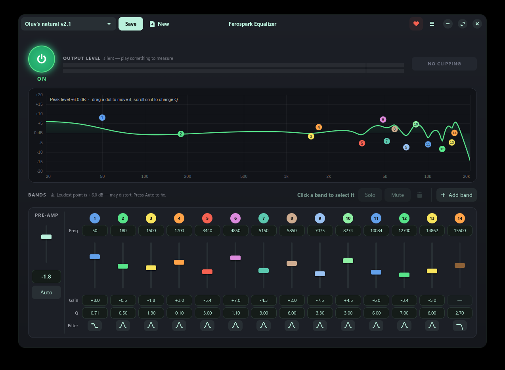

# Ferospark Equalizer

**A Linux substitute for [Peace Equalizer](https://sourceforge.net/projects/peace-equalizer-apo-extension/).**
If you used Peace + Equalizer APO on Windows and miss it on Linux, this gives you the same
kind of simple, all-bands-on-one-screen equalizer for your whole system's sound.



Under the hood the sound is processed by [EasyEffects](https://github.com/wwmm/easyeffects).
Ferospark Equalizer is a friendlier front-end for its output equalizer. It does not process
audio itself.

## Features

- **Peace-style band strip**: every band is a column with its frequency on top, a gain slider,
  and Gain / Q / Filter underneath. Type a value and press Enter.
- **Response curve**: see the overall EQ shape and drag points on it.
- **Pre-amp with anti-clipping**: an "Auto" button sets the pre-amp so boosts don't clip, and a
  clip light warns you when the real output clips (with a one-click Fix).
- **Filter types**: peak, low/high shelf, low/high pass, notch and band pass (up to 32 bands).
- **Solo / Mute** a band to hear what it does (listening aids only, never saved).
- **Presets**: create (start flat or copy the current sound), save, save as and delete. Presets
  are normal EasyEffects presets, so they also show up in EasyEffects.
- **Import, like Peace**: bring in your Peace presets (`.peace`), Equalizer APO config files,
  [AutoEQ](https://autoeq.app) headphone corrections (ParametricEQ.txt or GraphicEQ.txt) and
  REW filter exports.
- **One big power button**: switches the equalizer on or off, and remembers it across reboots.
  It only touches the equalizer, so anything else you use in EasyEffects keeps working.

## Before you start: EasyEffects is required

Ferospark Equalizer does **not** process sound by itself. The sound is processed by
**EasyEffects**, and this app controls it. **Without EasyEffects installed, the app will not work.**
If you open the app without it, it tells you so and links back here.

Both EasyEffects versions in use today are supported:

| EasyEffects | Supported |
|---|---|
| **7.x** (the older GTK version) | Yes |
| **8.2.8 or newer** (the current Qt version), as a normal package or a Flatpak | Yes (new, please [report problems](https://github.com/matewinslet/ferospark-equalizer/issues)) |
| 8.0 to 8.2.7 | No: these can't be controlled by other apps yet. Update EasyEffects. |

Your computer also needs to use **PipeWire** for sound. Almost every desktop Linux released since
2022 does.

### Step 1: install EasyEffects

Use whichever of these matches your system. Your distribution's own package is the best choice.

**Ubuntu, Zorin OS, Linux Mint, Pop!_OS, Debian and similar:** open a terminal and run

```bash
sudo apt update
sudo apt install easyeffects
```

**Fedora:**

```bash
sudo dnf install easyeffects
```

**Arch, Manjaro, EndeavourOS:**

```bash
sudo pacman -S easyeffects
```

**Any distribution, through Flatpak.** Use this if your distribution's EasyEffects is 8.0 to
8.2.7, for example **Ubuntu 26.04**, which ships 8.1. Remove the distribution's version first
(`sudo apt remove easyeffects` on Ubuntu) so only one EasyEffects runs:

```bash
flatpak install flathub com.github.wwmm.easyeffects
```

Then check the version (for the Flatpak, look at the Version line of
`flatpak info com.github.wwmm.easyeffects`):

```bash
easyeffects --version
```

Any 7.x version, or 8.2.8 or newer, is fine.

You don't have to set anything up inside EasyEffects. Ferospark Equalizer starts it in the
background, and if the equalizer effect is missing it shows an **Add equalizer** button.

### Step 2: install what the app itself needs

On Debian, Ubuntu, Zorin and Mint:

```bash
sudo apt install git python3-gi python3-gi-cairo gir1.2-adw-1 python3-numpy pipewire-bin pulseaudio-utils
```

On Fedora:

```bash
sudo dnf install git python3-gobject python3-cairo libadwaita python3-numpy pipewire-utils pulseaudio-utils
```

On Arch:

```bash
sudo pacman -S git python-gobject python-cairo libadwaita python-numpy pipewire libpulse
```

### Step 3: install Ferospark Equalizer

```bash
git clone https://github.com/matewinslet/ferospark-equalizer.git
cd ferospark-equalizer
./install.sh
```

The installer checks that everything above is present and tells you what is missing. Then open
**Ferospark Equalizer** from your app menu.

To remove it later, run `./install.sh --uninstall` from the same folder. EasyEffects and your
presets are left alone.

## Presets included

On first launch the app adds eight starter presets. They all begin with "Ferospark –" so they
stay grouped and never replace a preset you already have:

| Preset | What it does |
|---|---|
| Flat | 10 bands at 0 dB, a clean starting point |
| Bass Boost | More low end |
| Bass Reducer | Less boom from bass-heavy headphones or speakers |
| Treble Boost | Brighter sound for dull headphones |
| Vocal Clarity | Clearer voices in films and videos |
| V-Shape | Bass and treble up together |
| Speech & Podcasts | Focused, clear speech for calls and podcasts |
| Late Night | Softer bass and highs for low-volume listening |

Each one has its pre-amp set so it doesn't clip. You can edit or delete them like any other
preset, and a deleted one won't come back.

### Importing presets from Peace, Equalizer APO and AutoEQ

Click **Import** and pick a file. It becomes a new preset and is used right away.

- **Peace presets** (`.peace`): copy them over from your Windows PC. They live in Equalizer
  APO's `config` folder, usually `C:\Program Files\EqualizerAPO\config`.
- **Equalizer APO config files** (`.txt`), including the `peace.txt` file that Peace writes.
- **AutoEQ** headphone corrections from [autoeq.app](https://autoeq.app): choose
  *Equalizer APO* and download `ParametricEQ.txt` (best) or `GraphicEQ.txt`.
- **REW** filter exports (*Export filter settings as text*).

Only the equalizer is imported. Peace's settings for individual speakers, delays and similar
extras are left out, and the app tells you when that happens. Peace's steep Butterworth and
Linkwitz-Riley filters become ordinary 12 dB/octave filters, and a GraphicEQ curve is matched
with 31 bands.

## Good to know

- The app starts the EasyEffects background service if it isn't running.
- It adds a small login entry (`~/.config/autostart/io.github.matewinslet.FerosparkEqualizer-restore.desktop`)
  that starts EasyEffects at login and puts the equalizer back on or off as you left it. It
  replaces EasyEffects' own `easyeffects-service.desktop` autostart entry, if you have one.
- You can keep using EasyEffects for other effects (compressor, bass enhancer, noise
  removal…) alongside this app. Ferospark Equalizer only changes the equalizer.
- Presets live in EasyEffects' own preset folder: `~/.config/easyeffects/output/` for
  EasyEffects 7, `~/.local/share/easyeffects/output/` for EasyEffects 8, and
  `~/.var/app/com.github.wwmm.easyeffects/data/easyeffects/output/` for the Flatpak.
- With EasyEffects 8, other apps can't change the effects list. If the current preset has no
  equalizer, **Add equalizer** explains how to add it in EasyEffects (your other effects stay),
  or lets you load the "Ferospark – Flat" preset instead.

## Support development

If this app helps you, you can donate with Binance Pay (heart button in the app, or
Binance Pay ID **User-ec639**).


## License

[MIT](LICENSE). Ferospark Equalizer is an independent project and is not affiliated with Peace,
Equalizer APO or EasyEffects.
